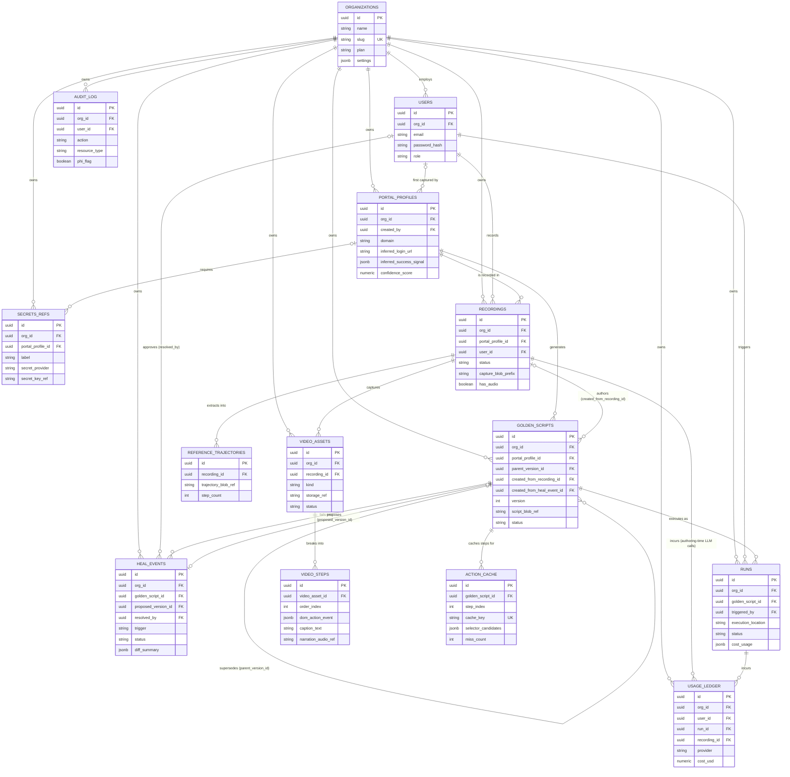

# Atlas AI — Database Design

**Status:** Companion to `2026-08-12-atlas-ai-production-architecture-design.md`, §5
**Schema source of truth:** [`db/schema.sql`](../../../db/schema.sql)
**Date:** 2026-08-12

This document expands the architecture spec's data-model summary into a full schema: 14 tables across six domains, with an ER diagram, per-table field reference, and the cross-cutting design decisions that shaped it.

## Entity-relationship diagram

A rendered, styled version of this same diagram with the full field reference is published as an artifact for easier review (see conversation).

## Design decisions

**`org_id` on every table, from Phase 0.** Even while the product is single-org internal use, every table carries `org_id` and cascades from `organizations`. This means Phase 3 multi-tenancy is a query-scoping concern, not a migration that touches every table.

**Postgres holds metadata; Blob Storage holds bytes.** No table stores a script, screenshot, video, HAR file, or trace directly — every such artifact is a `*_blob_ref` / `*_ref` string pointing into Blob Storage. This keeps the database small, fast, and cheap to back up, and matches the architecture spec's local-first design: the desktop app can write these blobs locally first and sync the reference row after.

**`golden_scripts` is append-only and self-referential, not update-in-place.** A "new version" is a new row with `parent_version_id` pointing at the one it supersedes, and `status` tracking which version is currently `active`. This is what makes the heal-and-approve workflow (architecture spec §7.3) possible: the previous `active` version keeps serving production runs, untouched, while a `draft` version is reviewed.

**The `golden_scripts` ↔ `heal_events` circular reference is intentional.** A `heal_events` row points at the `golden_scripts` row that failed (`golden_script_id`) and, once repaired, at the new version it produced (`proposed_version_id`). A `golden_scripts` row can in turn record which `heal_events` row it was created from (`created_from_heal_event_id`). Postgres handles this cleanly as two independently nullable foreign keys — `schema.sql` creates `golden_scripts` first with that column un-constrained, creates `heal_events`, then adds the constraint back via `ALTER TABLE`.

**`action_cache` is keyed to exclude parameter values.** `cache_key` is a hash of the step's instruction, a normalized URL pattern, and a DOM/accessibility-tree fingerprint — deliberately never the actual values a script was run with (a date, a patient ID). This means the same golden script run against different input data still hits the same cache entries, which is the property that makes the cache useful at all (see architecture spec §7.1 and §17 for why this mirrors Stagehand's cache-key design).

**`video_assets` / `video_steps` exist from Phase 0 even though the editor is Phase 2.** The tables are here now because the capture layer starts recording the data they need (per-step screenshots, optional narration audio) from day one — see architecture spec §8.2. An empty `video_steps` table costs nothing; retrofitting step-level capture into recordings that were never captured that way would cost a lot.

**`audit_log` exists from Phase 0 but is not yet enforced.** The table and its `phi_flag` column exist so that Phase 3 compliance hardening (architecture spec §13) is a matter of *writing to* this table everywhere it should already be written, not designing a new one under time pressure later.

## Indexing strategy

Beyond primary/foreign keys, `schema.sql` adds:
- `UNIQUE (org_id, domain)` on `portal_profiles` and `UNIQUE (portal_profile_id, version)` on `golden_scripts` — the natural business keys.
- A partial index `golden_scripts (portal_profile_id, status) WHERE status = 'active'` — the single most common lookup ("what's the live script for this portal right now") stays a fast index scan even as version history grows.
- A partial index `heal_events (org_id, status) WHERE status = 'pending_approval'` — backs the approval-queue view in the dashboard directly.
- Descending time indexes on `recordings`, `runs`, `usage_ledger`, and `audit_log` for the recency-ordered lists every dashboard view will need.
